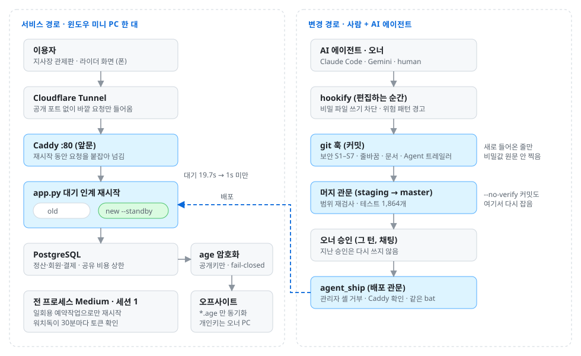
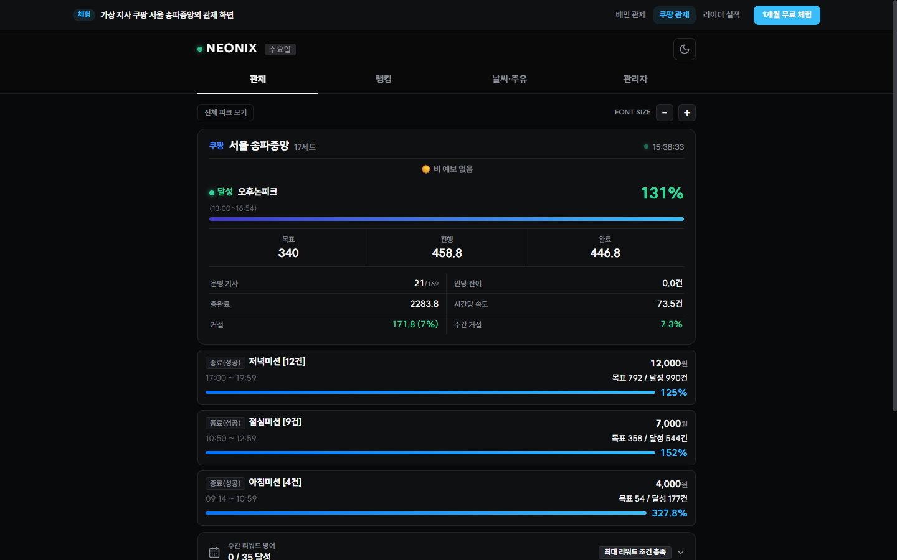
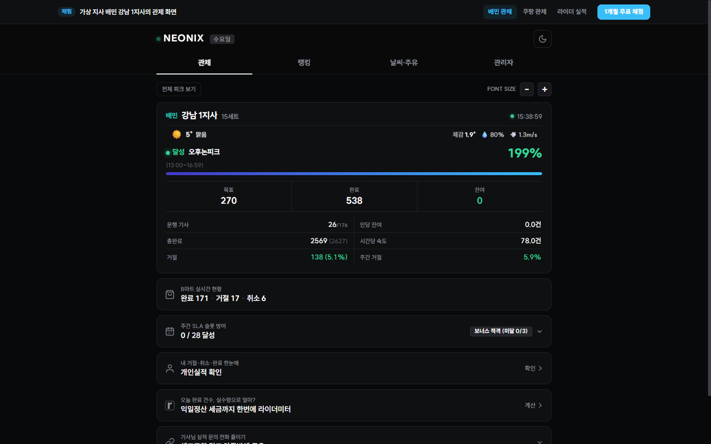
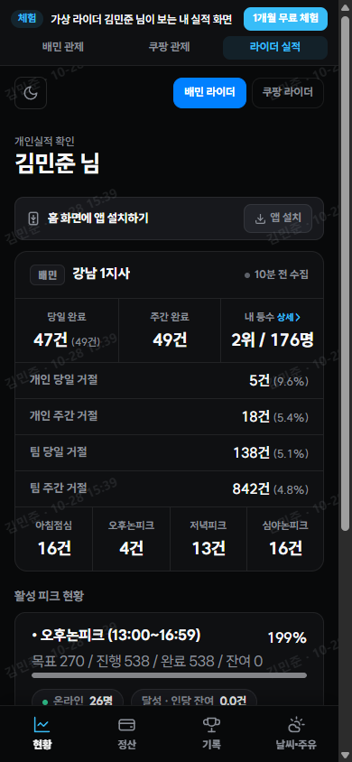

# NEONIX_TEC 운영·보안 도구

**NEONIX_TEC 이 직접 설계·개발·운영하는 배달 지사 관제·정산 SaaS 에서 만든 운영·보안 도구 모음.**
윈도우 서버 한 대에서 무중단 배포, 암호화 백업, 그리고 여러 AI 코딩 에이전트를 규칙으로 통제하는 개발 방식을 코드로 관리한다.

     

<p align="center">
  
</p>

<p align="center">
  
  
  
</p>
<p align="center"><sub>운영 중인 SaaS 의 공개 체험 화면 (가상 지사·가상 라이더 데이터)</sub></p>

## 운영 중인 서비스

| 항목 | 내용 |
|---|---|
| **SaaS** · 2026년 6월~ | 배달 지사장용 관제판·정산, 라이더용 실적 화면. 개발과 동시에 실사용, 이후 무중단 운영 |
| **디스코드 관제 봇** · 2025년 11월~ | 운영 알림·관제 카드. 1년 가까이 무중단 운영 |
| 실사용 기능 | 회원·요금제 결제와 입금 매칭, 관리자·지사장 2FA(TOTP, 백업 코드 복구), 무중단 배포, age 암호화 오프사이트 백업 |
| 개발 방식 | 여러 AI 코딩 에이전트(Claude Code, Gemini)를 규칙으로 통제하며 개발·운영. 사람이 모든 diff 를 읽지 않아도 같은 관문을 통과해야 반영 |

## 이 레포에서 쓸 수 있는 것

| 폴더 | 한 줄 | 대표 파일 |
|---|---|---|
| [`agent-guardrails/`](agent-guardrails) | AI 에이전트가 커밋하는 레포의 관문: 보안 스캐너 S1–S7, 줄바꿈·문서·작성자 린트, git 훅, hookify 규칙, 사고 기록 기반 리뷰 스킬 | [`security_scan.py`](agent-guardrails/security_scan.py) |
| [`windows-ops/`](windows-ops) | 윈도우 서버 무중단 운영: 관리자 권한 없이 재시작, 대기 인계, 앞문 Caddy, 승인 뒤에만 도는 배포 관문 | [`restart_app_medium.ps1`](windows-ops/restart_app_medium.ps1) |
| [`backup-encryption/`](backup-encryption) | 오프사이트 백업을 공개키로만 잠그고(fail-closed), 오너 PC 에서만 열어 검증 | [`age_encrypt.py`](backup-encryption/age_encrypt.py) |
| [`csp-migration/`](csp-migration) | CSP `'unsafe-inline'` 제거용 30줄 이벤트 위임 + CDN 캐시를 비켜 가는 내용 해시 | [`nx_on.js`](csp-migration/nx_on.js) |
| [`ai-support-bot/`](ai-support-bot) | 운영 중인 AI 상담봇 구조 데모: 지식 문서 핫리로드, API 키 1~3개 failover·재시도·마감 호출 래퍼, 장애 알림, 개인정보 마스킹 로그. Gemini·Claude 교체 가능 | [`llm.py`](ai-support-bot/support_bot/llm.py) |

## 설계 요약

| 주제 | 문제 | 해결 | 결과 |
|---|---|---|---|
| **무중단·권한** | 관리자 권한 프로세스 하나가 매일 05:51 일일 재시작 18개를 통째로 멈출 수 있고, 재시작마다 :80 이 몇 초 빈다 | 일반 권한 일회용 예약작업으로만 재시작, 새 앱을 먼저 띄워 두는 대기 인계, 앞문 Caddy 가 요청을 붙잡음, 토큰을 직접 읽는 권한 감시 | 재시작 대기 최대 19.7초 → **1초 미만**, 전 프로세스 Medium·세션 1 |
| **암호화 백업** | 클라우드 동기화 폴더라면 클라우드 계정 하나가 운영 비밀 전체가 된다 | 서버엔 공개키만, `.part` 검증 후 rename, 개인키가 섞이면 거부, 실패하면 아무것도 안 내보냄 | 오프사이트엔 `*.age` 만, 월 1회 복원 연습 |
| **AI 거버넌스** | 규칙은 문서에 있어도 새 코드 경로가 안 탈 수 있고, 에이전트는 기억이 없다 | 편집 순간(hookify) → 커밋(S1–S7·문서·작성자) → 머지(범위 재검사·전체 테스트) → 오너 승인 배포 | 어떤 에이전트든 같은 관문, 모든 커밋에 작성자 |

자세한 설계와 구현 디테일: **[docs/DESIGN.md](docs/DESIGN.md)**

## 쓰는 법

```bash
git config core.hooksPath agent-guardrails/githooks   # 커밋마다 린트 + 보안 스캔
python agent-guardrails/security_scan.py --all         # 전체 트리 점검
```
각 파일 머리 주석에 입력·출력·설정(env)·주의가 있다. 윈도우 스크립트는 PowerShell 5.1 기준이고, 콘솔 출력은 한국어 윈도우(CP949)에서 깨지지 않게 대부분 ASCII 다.

## English summary

Operations and security tooling from a delivery-branch SaaS that NEONIX_TEC designs, builds and runs on a single Windows server, developing with several AI coding agents kept in line by enforced rules.
- **Zero-downtime restarts**: standby handover behind Caddy cut the worst-case restart wait from 19.7 s to under 1 s; every process is verified non-elevated (Medium integrity, desktop session).
- **Encrypted offsite backups**: age public-key encryption on the server, fail-closed, private key only on the owner's PC.
- **Agent governance**: edit-time hookify rules, commit hooks with security rules S1–S7, a merge gate that re-checks the whole range, and an approval-gated deploy helper.
- **CSP migration**: a 30-line event-delegation dispatcher to drop `'unsafe-inline'`, plus content-hash cache busting.
- **AI support bot**: hot-reloaded knowledge file, an LLM call wrapper with 1-3 API keys and failover, retries, a deadline and serialization, throttled outage alerts and a masked chat log; Gemini or Claude behind one adapter interface.
- Business logic and customer data are not included. MIT licensed.

## 라이선스

[MIT](LICENSE)
