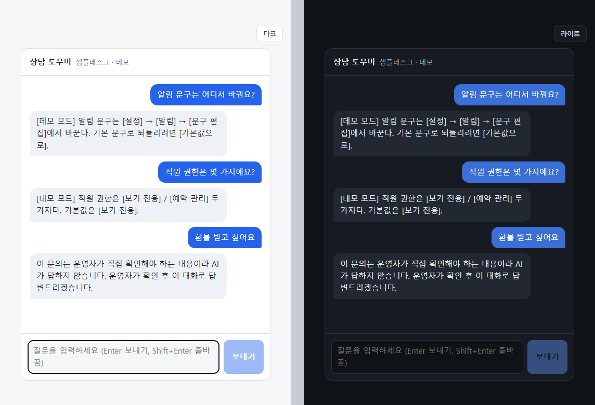

# AI 상담봇 구조 데모

NEONIX_TEC 이 운영 중인 SaaS 의 1:1 AI 상담봇 구조를, 운영 코드를 복사하지 않고 작은 패키지로 다시 짠 데모다.
지식 문서·고객 데이터·실제 프롬프트는 들어 있지 않다. 지식 문서는 가상의 서비스 "샘플데스크" 예시다.
운영은 Gemini API 로 돌고, 이 데모는 Gemini·Claude 를 바꿔 끼울 수 있게 어댑터를 나눴다.
API 키는 1개가 기본이고, 설정으로 2~3개를 등록하면 한 키에 장애가 났을 때 다음 키로 넘어간다(failover).

<p align="center"></p>
<p align="center"><sub>React 채팅 위젯 (라이트 / 다크) · 키 없이 도는 데모 모드 · 가상 서비스 데이터</sub></p>

```
브라우저 (React 위젯) ─ POST /api/chat ─▶ FastAPI (server/) ─▶ SupportBot.answer
                                              └─ 클라이언트별 분당 20회 + 전체 분당 600회 상한

질문 ─▶ KeywordGuard ─(환불·해지·소송…)─▶ 고정 안내 (모델 호출 없음)
          │
          ▼
     SupportBot.system_text()  =  BEHAVIOR(행동만, 코드)  +  KnowledgeBase(사실만, md 파일·핫리로드)
          │
          ▼
     LLMCaller ── API 키 1개(기본) ~ 3개 failover · 직렬화 락 · 0.8초 간격 · 2바퀴 · 45초 마감
          │            ├─ 401/403 받은 키는 그 키만 빼고 알림 ("key 2", 키 값은 안 씀)
          │            └─ 장애 알림: 종류별 30분 1회 + 복구 1회 (키·프롬프트 본문 없음)
          ▼
     provider 어댑터 (Gemini / Claude) ─▶ 답변 ─▶ ChatLog (전화·메일·주민번호·카드번호 마스킹, 사용자 id 는 HMAC)
```

## 파일

| 파일 | 하는 일 |
|---|---|
| [`support_bot/kb.py`](support_bot/kb.py) | 지식 문서 핫리로드 — mtime 이 바뀌면 다시 읽음, 실패해도 예외 없이 마지막 사본 |
| [`support_bot/llm.py`](support_bot/llm.py) | LLM 호출 래퍼 — 키 1~3개 failover·재시도·마감·직렬화·거부된 키 제외 |
| [`support_bot/alerts.py`](support_bot/alerts.py) | 장애 알림 — 종류별 30분 1회, 첫 성공에 복구 1회 |
| [`support_bot/chatlog.py`](support_bot/chatlog.py) | 상담 로그 — 개인정보 마스킹 후 JSONL |
| [`support_bot/guard.py`](support_bot/guard.py) | 돈·법·계정 보안 질문은 모델 대신 사람에게 |
| [`support_bot/bot.py`](support_bot/bot.py) | 조립: 가드 → 지식 → 모델 → 로그. 행동 프롬프트는 긍정형 2단계 |
| [`support_bot/providers/`](support_bot/providers) | Gemini(google-genai)·Claude(anthropic) 어댑터 — 업체 오류를 공통 오류로 번역 |
| [`knowledge/faq.md`](knowledge/faq.md) | 가상 서비스 지식 문서 예시 |
| [`server/`](server) | FastAPI: `POST /api/chat`, 클라이언트별·전체 분당 상한(주소를 바꿔 가며 쏴도 한도 중인 클라이언트 기록은 안 지워짐), 키 없이 도는 데모 provider, `web/dist` 가 있으면 화면도 같이 제공 |
| [`web/`](web) | Vite + React + TypeScript 채팅 위젯: 메시지 목록·입력·답변 쓰는 중 표시·원인별 실패 문구·라이트/다크. 상태는 `useReducer` 하나 |
| [`tests/`](tests) | 파이썬 37개 — 실제 API 없이 가짜 클라이언트·가짜 시계, API 는 FastAPI TestClient |
| [`web/src/*.test.ts(x)`](web/src) | 화면 11개 — Vitest + Testing Library, 서버 없이 가짜 전송 함수 |

## 왜 이렇게 했나 — 운영 실측 한 줄씩

| 결정 | 운영에서 본 것 |
|---|---|
| **API 키 1개 기본, 2~3개면 failover** | 키 하나로 운영하고, 키를 더 등록하면 한 키의 429·5xx·타임아웃 때 같은 모델로 다음 키를 쓴다. 키 수만큼 분당 한도가 늘어나는 게 아니라 한 키의 일시 장애를 넘기는 용도다 |
| **등록한 키·모델 밖으로 나가지 않고, 실패하면 "잠시 후 다시"** | 모델마다 답의 품질이 다르다. 실패를 다른 모델로 몰래 메우면 같은 질문의 답이 그때그때 흔들린다 — 틀린 답보다 잠시 후 다시가 낫다 |
| **2바퀴 재시도 + 45초 마감** | 한 바퀴 실패 뒤 2초 쉬고 한 바퀴 더 — 운영 대조 중 연결 끊김 1회를 둘째 바퀴가 받아냈다 |
| **호출당 20초** | 10초는 지식 문서가 커지면서 빠듯해졌다. 20초로 늘린 뒤 타임아웃 1건을 재시도가 22.6초에 건졌다 |
| **실패 문구는 원인별, '또는' 금지** | "한도 초과 또는 네트워크 장애" 한 문장 때문에 진짜 원인(읽기 타임아웃)을 키 부족으로 오진했다. 두 원인은 대응이 정반대다 |
| **401/403 받은 키는 그 키만 빼고 알림** | 거부된 키로 재시도하면 마감 시간만 태운다. 남은 키로 계속 답하고, 키를 고친 뒤 재시작하면 다시 쓴다. 모든 키가 거부되면 그때 실패 |
| **모델은 버전 고정 먼저, 별칭은 마지막** | 별칭은 업체가 가리키는 곳을 바꾸면 코드 한 줄 안 고쳐도 한도가 1/3 로 내려앉을 수 있다 |
| **직렬화 락 + 0.8초 간격** | 키가 여러 개여도 failover 는 "어느 키"만 정할 뿐 "동시에 몇 개"는 못 막는다. 5개 동시 요청이 1.7·4.0·6.0·7.7·9.4초 계단으로 끝났다(병렬이면 모두 2초 근처에서 한도에 부딪힌다) |
| **장애 알림 30분 1회 + 복구 1회, 본문에 키·프롬프트 없음** | 다른 모델로 메우지 않으니, 알림이 없으면 고객 화면에만 "잠시 후 다시"가 뜨고 운영자는 모른다 |
| **지식은 md 파일, 핫리로드** | 프롬프트가 코드 상수면 한 줄 고칠 때마다 웹서버 재기동이 필요했다. 파일로 빼고 5초 안에 반영, 재기동 0 |
| **프롬프트엔 행동만, 사실은 지식 문서 한 곳** | 같은 사실이 두 곳에 있으면 낡은 쪽이 이겼다 — 지식 문서에 맞는 메뉴 경로를 써 놔도 프롬프트의 옛 경로를 답했다 |
| **긍정형 2단계 절차** | "이 말 반복하지 마"라고 금지 문장을 프롬프트에 쓰자 그 문장을 거의 그대로 출력했다(프라이밍). 절차로 바꾼 뒤 4문항 연타에 운영자 떠넘기기 0회 |
| **max_tokens 900** | 연타 질문을 합친 한 턴에 600 이면 셋째 답부터 눌려 뭉개졌다 |
| **고객 대면 전용 지식 문서** | 내부 문서를 통째로 넣으면 다른 고객의 조건이 새고, 개발자용 경고문을 고객에게 옮기며 품질도 떨어진다 |
| **돈·법·보안 질문은 가드** | 환불·해지·소송·비밀번호는 모델이 답할 일이 아니다 — 모델 호출 없이 바로 사람에게 |

## 쓰는 법

```python
from support_bot import AlertGate, ChatLog, KeywordGuard, KnowledgeBase, LLMCaller, SupportBot
from support_bot.providers.gemini import GeminiClient      # 또는 providers.claude.ClaudeClient

keys = load_secrets()                                      # 비밀 저장소에서 1~3개. 이 패키지는 env·파일을 직접 읽지 않는다
clients = [GeminiClient(api_key=k) for k in keys]          # 키 1개 = 클라이언트 1개, 이 순서로 failover
gate = AlertGate(send=post_to_ops_channel)                 # (title, body) -> 알림 채널
caller = LLMCaller(clients, models=["<고정 버전 2>", "<고정 버전 1>", "<별칭>"], alerts=gate)
bot = SupportBot(caller, KnowledgeBase("knowledge/faq.md"), KeywordGuard(),
                 ChatLog("logs/chat.jsonl", salt=load_secret("log-salt")))

print(bot.answer(user_id, "예약 알림 문구는 어디서 바꿔요?").text)
```

모델을 바꾸려면 어댑터만 바꾼다(`ClaudeClient()` 기본 모델 `claude-opus-5-5`). 재시도·마감·알림 규칙은 `LLMCaller` 한 곳이라 그대로다.

## 채팅 화면 실행 (키 없이 데모 모드)

```bash
# 1) API 서버
cd ai-support-bot
python -m venv server/.venv
server/.venv/Scripts/python -m pip install -r server/requirements.txt     # macOS/Linux: server/.venv/bin/python
server/.venv/Scripts/python -m uvicorn server.app:app --port 8000

# 2) 화면 (다른 터미널) - http://localhost:5173, /api 는 8000 으로 프록시
cd ai-support-bot/web
npm install
npm run dev
```

한 프로세스로 보려면 `npm run build` 뒤 1)만 띄우고 http://localhost:8000 을 연다(서버가 `web/dist` 를 같이 낸다).
프록시(CDN·리버스 프록시) 뒤에 둘 때는 `uvicorn server.app:app --proxy-headers --forwarded-allow-ips=<프록시 주소>` 로 띄운다 — 그래야 사람별 상한이 프록시 IP 하나로 합쳐지지 않고, 신뢰한 프록시가 준 주소만 클라이언트 IP 로 쓴다(앱 코드는 전달 헤더를 직접 읽지 않는다, 위조되므로).
실제 모델로 바꾸려면 서버를 띄우는 셸에 `SUPPORT_BOT_PROVIDER=gemini`(또는 `claude`), `SUPPORT_BOT_API_KEYS=키1,키2`, `SUPPORT_BOT_MODELS=…` 를 준다. 키는 그 프로세스 환경으로만 넣고 레포 파일에는 두지 않는다.

요청 상한은 일부러 "막히는 쪽"으로 정했다. 답 하나가 API 호출 하나라, 대량 요청이 오면 비용이 새는 것보다 잠깐 모두 막히는 쪽이 낫다. 봇 대량 요청에 대한 가용성은 이 프로세스 앞단의 일이다 — 실제 서비스는 CDN/WAF 봇 차단 뒤에 둔다(운영은 Cloudflare).

화면에서 지킨 것:
- 실패 문구는 원인별 한 문장 — 연결 실패 / 60초 초과 / 질문 과다(429) / 입력 오류(422) / 서버 오류를 각각 다르게 쓴다. 서버 쪽 실패(키 거부·전부 실패)는 서버가 준 원인별 문장을 그대로 보여 준다.
- 보내는 동안 "답변 쓰는 중" 점 3개, 보내기 버튼 잠김. 한글 입력 중 Enter(조합 확정)로 잘못 보내지 않게 `isComposing` 을 본다.
- 라이트/다크는 CSS 변수 한 벌. 첫 방문은 OS 설정을 따르고, 고른 값은 localStorage(막혀 있으면 그냥 안 남김).

## 테스트

```bash
server/.venv/Scripts/python -m pytest -q tests      # 파이썬 37개 (fastapi 가 없으면 API 테스트 7개는 건너뜀)
cd web && npm test                                   # 화면 11개
```

실제 API 를 부르지 않는다. 가짜 클라이언트가 정해진 순서로 답·오류를 돌려주고, 가짜 시계가 `sleep` 을 즉시 처리해서 45초 마감·30분 알림 창도 0.5초 안에 검증된다. 직렬화 테스트만 진짜 스레드 5개로 "동시에 1건만 나간다"를 잰다.

빠진 것(운영에는 있음): 연타 디바운서(2.5초 안 연속 입력을 합침), 운영자 개입 시 AI 30분 침묵, 타이핑 표시, 운영자 호출 버튼, 실제 질문 세트로 돌리는 회귀 평가(수동 실행 — 자동 테스트에 넣으면 실행마다 실제 API 를 불러 비용이 든다).
